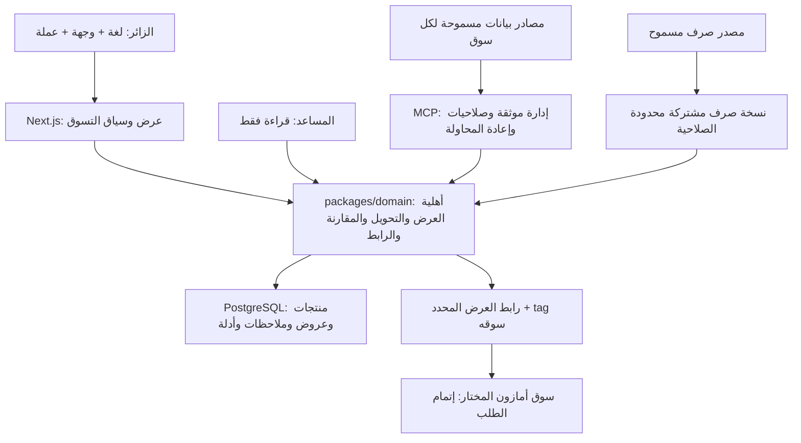

# BabiesPicks: واجهة عالمية وأسعار حسب وجهة التوصيل

التاريخ: 2 نوفمبر 2026. الحالة: **INCOMPLETE — تحليل ومقترح يحتاج حسم مصدر بيانات الأسعار قبل خطة التنفيذ**.

## القرار الذي اتخذه المالك

واجهة الموقع عالمية، مع دعم وجهتَي التوصيل السعودية وأمريكا أولًا. يمكن أن تأتي العروض من متاجر أمازون المختلفة. وجود برايم ليس شرطًا. اللغة الحالية عربية وإنجليزية. قبول هذا الاتجاه لا يعني اعتماد تفاصيل التصميم أدناه أو الإذن بالتنفيذ والنشر.

المقترحات التالية من المنفذ، وليست قرارات وافق عليها المالك: طريقة تحديد التفضيلات، سياسة التحويل والترتيب، البيانات الجديدة، ومراحل الانتقال.

## الخلاصة العملية

التغيير يمتد إلى عقد السعر وإدارة المحتوى وقاعدة البيانات ومحرك اختيار العرض والواجهة والتحويل إلى المتجر والمساعد والكوبونات والتحليلات وبيانات محركات البحث. تعديل العنوان وحده يغير الوعد التسويقي دون توفير المقومات اللازمة له.

أوصي بالإبقاء على Next.js وMCP وPostgreSQL ومالك قواعد الأعمال الحالي `packages/domain`. لا يوجد دليل يستدعي خدمة مستقلة للعملات، حسابات مستخدمين، GPS، أو حساب جمارك شامل في البداية.

النسخة الأولى المقترحة: هوية عالمية؛ وجهة توصيل يختارها الزائر؛ سعر أصلي بعملته؛ تحويل إرشادي إلى SAR أو USD عند توفر مصدر مسموح؛ حالة توصيل موثقة بحدودها؛ رابط العرض نفسه؛ بيانات عمولة مستقلة لكل متجر. لا ندّعي معرفة إجمالي الدفع أو أهلية عنوان بعينه دون دليل.

## نطاق الأدلة وحدودها

راجعت الشيفرة المحلية على `main` عند `a6c732ae8922cef1c63a18030242a095cf60620b`. توجد تسعة ملفات معدلة من مهمة النصوص السابقة؛ بقيت محفوظة. هذا التحليل لا يثبت نسخة الإنتاج أو محتويات قاعدة البيانات أو حسابات العمولة أو صلاحية مفاتيح API. لم تُقرأ أسرار، ولم تُجرَ طلبات شراء أو كتابة على قاعدة بيانات.

المصادر الخارجية الرسمية أدناه قُرئت في 2 نوفمبر 2026. السياسة المشار إليها تخص البرنامج/المتجر المذكور، ولا تُعمم تلقائيًا على جميع برامج أمازون.

## 1. خمس معلومات يجب فصلها

| المعلومة | معناها | كيف تؤثر؟ |
|---|---|---|
| مكان الاتصال | البلد التقريبي لاتصال الزائر | اقتراح اختياري فقط؛ السفر وVPN لا يغيران رغبة الشراء |
| وجهة التوصيل | البلد الذي يريد إرسال الطلب إليه | صلاحية العرض والشحن والضرائب المحتملة |
| لغة الواجهة | العربية أو الإنجليزية | النصوص والاتجاه والتنسيق، دون افتراض جنسية أو وجهة |
| عملة العرض | SAR أو USD في البداية | حسابات العرض والميزانية والترتيب، دون تغيير السعر المصدر |
| سوق أمازون | الأمريكي أو السعودي أو البريطاني مثلًا | هوية القائمة والعملة المرصودة والعمولة وشروط الشراء |

أمثلة: زائرة عربية في أمريكا قد تطلب هدية للسعودية، وزائر إنجليزي في السعودية قد يشتري لعنوان أمريكي. كلاهما يجب أن يختار الوجهة والعملة واللغة بصورة مستقلة. اختيار أمريكا لا يعني قصر النتائج على amazon.com؛ أي عرض من سوق آخر يملك دليل توصيل مناسبًا يمكن أن يظهر.

## 2. ما أثبته الكود الحالي

| المسار المالك | الوضع الحالي | أثر التوسع |
|---|---|---|
| `packages/domain/src/contracts.ts:34` | `currency` محصورة في SAR | أسعار USD وGBP وEUR وغيرها مرفوضة عند الكتابة |
| `apps/web/src/server/public-queries.ts:38` | يستبعد الأسعار غير SAR | تعديل العرض وحده لن يجعل أسعار العملات الأخرى تظهر |
| `packages/domain/src/prices.ts:64` | رابط الشراء يستبعد غير SAR | قد تعرض الواجهة سعرًا بينما يفشل زر المتجر إذا لم تتغير الطبقتان معًا |
| `packages/domain/src/prices.ts:7` | أحدث ملاحظة لكل `storeId`، وصلاحية عامة 48 ساعة | لا يفصل البائع أو القائمة أو الوجهة أو سعر برايم |
| `apps/web/src/shared/lib/catalog-filters.ts:21` | اختيار السعر بطرح الأرقام مباشرة | لا يصلح لمقارنة عملتين، والفئات السعرية ثابتة |
| `packages/db/prisma/schema.prisma:399` | السعر Decimal والعملة String | توجد نواة جيدة، لكن لا يوجد سياق توصيل أو عضوية أو بائع |
| `packages/db/prisma/schema.prisma:231` | اسم متجر واحد ورابط بلا تعريف سوق منظم | نحتاج سوقًا معتمدًا وأسماء محلية وإعداد عمولة لكل سوق |
| `apps/web/src/shared/components/sar-price.tsx` | يرسم رمز الريال لكل مبلغ | يشمل البطاقات والتفاصيل والشريط الثابت والمساعد |
| `apps/web/src/shared/components/product-details-view.tsx:70` | `priceCurrency` ثابتة SAR | البيانات المنظمة تحتاج نفس حقيقة السعر الظاهر |
| `packages/domain/src/prices.ts:31` | tag عام يتغلب على إعداد المتجر في sa وcom | قد يستبدل معرّف سوق بمعرّف سوق آخر؛ لا نثبت وضع الحسابات الفعلي |
| `apps/web/src/shared/lib/product-details.ts:12` | مصادر تقييم أمازون مقبولة لثلاثة نطاقات فقط | تقييم بريطاني أو ألماني موثق لن يظهر كتقييم أمازون حاليًا |
| `apps/web/src/server/chat/chat-tools.ts:9` | بطاقة المساعد بلا عملة؛ حد الميزانية رقم فقط | سؤال «أقل من 100 دولار» لا يملك عقدًا ماليًا صحيحًا |
| `packages/db/prisma/schema.prisma:529` | الكوبون المالي بلا عملة | مبلغ الخصم والحد الأدنى قد يُعرضان خطأ بالريال |
| `apps/web/src/shared/components/analytics-events.tsx:13` | أحداث الضغط تحمل SAR دائمًا | تتلوث المقاييس عند تعدد العملات |
| `apps/web/src/i18n/routing.ts` | `/ar` و`/en`؛ الافتراضية ar | توجد لغتان؛ لا يوجد سياق تسوق مستقل عنهما |

تجربة محلية بمدخلات مصطنعة أثبتت: قبول SAR فقط؛ ترتيب 40 USD قبل 100 SAR كأرقام؛ فقد سياق SA عند وصول ملاحظة US أحدث للمتجر نفسه؛ تغلب tag عام مصطنع على tag أمريكي مصطنع. هذه تجارب وظائف محلية، وليست نتائج تشغيل إنتاجي.

## 3. رحلة المستخدم ومكان تصفحه

الاختيار الأول يكون خفيفًا ولا يمنع التصفح: «التوصيل إلى: اختر الوجهة»، «العملة: الأصلية»، ومبدّل اللغة. لا نطلب تسجيلًا أو عنوانًا أو إذن موقع. عند اختيار السعودية نقترح SAR، وعند اختيار أمريكا نقترح USD، ما لم يسبق اختيار عملة صراحة.

أولوية سياق التسوق: اختيار صالح في الرابط، ثم آخر اختيار صريح محفوظ، ثم وضع محايد. الموقع التقريبي لا يكتب فوق اختيار المستخدم. أقترح تأجيل تحديد البلد عبر IP؛ وجوده ليس شرطًا لتجربة صحيحة. لو أضيف لاحقًا يكون اقتراحًا قابلًا للرفض، عبر وسيط موثوق، دون GPS أو حفظ IP خام لهذا الغرض.

لغة المسار الصريح محفوظة دائمًا. زيارة الجذر يمكن أن تقترح لغة المتصفح، مع fallback إنجليزي للجمهور العالمي؛ لا نحوّل رابط `/ar/...` أو `/en/...` بسبب البلد. تغيير اللغة يبقي الوجهة والعملة والفلاتر المناسبة.

السياق المحفوظ يقتصر على البلد والعملة المختارين. لا نحتاج عنوانًا كاملًا. الرمز البريدي قد يضاف لاحقًا فقط إذا أثبت مصدر البيانات قدرته على إرجاع تقدير صالح له؛ البلد وحده لا يكفي لوعد توصيل شخصي.

زائر من بلد ثالث يستطيع تصفح الموقع واختيار إحدى الوجهتين. إن لم تكن تلك وجهته نوضح أن التحقق لبلده غير مدعوم بعد، ونبقي الأسعار الأصلية وروابط المتاجر دون ادعاء توصيل إليه.

## 4. سياسة العملة المقترحة

### ثلاث عملات ذات أدوار مختلفة

1. **عملة الملاحظة الأصلية:** العملة التي أرجعها المصدر فعلًا مع المبلغ والسياق. لا نستنتجها من اسم النطاق، ولا نعيد وسم رقم SAR بأنه USD.
2. **عملة العرض المفضلة:** SAR أو USD للنسخة الأولى، قابلة للتغيير دون تغيير اللغة أو الوجهة.
3. **عملة الدفع:** يحددها المتجر/الدفع. لا نضمنها أو نفترض أنها تطابق التحويل الإرشادي لدينا.

أمازون نفسه يفرّق بين Currency of Preference وPayment Total؛ هذا يسند إظهار تحويلنا كتقدير دون وعد بمبلغ البطاقة. [شرح أمازون](https://www.aboutamazon.co.uk/news/retail/how-to-change-currency-amazon).

### ماذا يظهر على البطاقة؟

السعر المصدر وعملته واضحان دائمًا. عند اختلاف التفضيل يظهر بجواره «نحو … SAR» أو «نحو … USD»، مع بيان أنه تحويل تقديري قبل البنود غير المعروفة. يمكن جعل التقدير أكبر بصريًا مع بقاء الأصل ملاصقًا وواضحًا؛ القرار البصري مؤجل.

لا يظهر `$` وحده عند احتمال التباس USD وCAD وAUD. نستخدم `Intl.NumberFormat` وفق اللغة والعملة، مع رمز ISO ظاهر عند الحاجة، وعزل اتجاه الأرقام. عدد المنازل العشرية يتبع العملة؛ JPY مثال لا يُعامل تلقائيًا كعملة ذات منزلتين. التخزين والحساب Decimal أو وحدات صغرى محددة، والتقريب عند العرض فقط.

### أسعار الصرف

نحتاج مصدرًا مسموحًا يغطي SAR وUSD وجميع عملات الأسواق المفعلة. يحتفظ النظام بزوج العملتين والسعر ووقت السريان ووقت الجلب والمصدر. لا حاجة لطلب سعر صرف عند كل بطاقة أو من المتصفح. تختار الاستجابة نسخة واحدة متسقة للتحويل والترتيب.

المعادلة: المبلغ المرجعي = المبلغ الأصلي × معامل التحويل المناسب. إن كان المصدر بقاعدة ثالثة نثبت اتجاه القسمة/الضرب ونختبره. لا نخلط سعر اليوم للسعر الحالي بسعر تاريخي لسعره المشطوب لصناعة خصم.

تحديث يومي مقترح يكفي للتحويل الإرشادي في البداية، بشرط سياسة عمر تتعامل مع عطلات المصدر. عند انتهاء الصلاحية أو غياب زوج عملات: نبقي الأصل، نحجب التحويل، ونمنع المقارنة متعددة العملات لذلك العرض. لا نستخدم آخر معدل بلا حد أو قيمة صفر. لا أختار مزودًا مدفوعًا دون تكليف. ECB مثال رسمي لمصدر إرشادي يومي، لكن قائمته المنشورة لا تغطي SAR؛ لذا لا يكفي وحده للمشروع. [مصدر ECB](https://www.ecb.europa.eu/stats/policy_and_exchange_rates/euro_reference_exchange_rates/html/index.en.html).

تنفيذ التحويل مشتق من بيانات السعر ومشروط أيضًا بما تسمح به رخصة مصدر البيانات؛ لم نثبت إجازة كل شكل عرض مقترح.

### سعر السلعة وإجمالي الشراء

نخزن ونوضح ما إذا كانت الضريبة مشمولة/غير مشمولة/مجهولة. الشحن والرسوم والاستيراد وخصومات العضوية بيانات مستقلة. `null` تعني مجهولًا، ولا تتحول إلى صفر. لا نحسب إجماليًا من أرقام لا تشترك في الوجهة والبائع والتوقيت والأساس الضريبي نفسه، ولا نضيف الضريبة مرتين.

في النسخة الأولى نقارن **سعر السلعة قبل الشحن والبنود غير المعروفة** داخل أساس ضريبي متجانس ووجهة متسقة فقط. السعر الشامل VAT والسعر غير الشامل لضريبة المبيعات لا يحصلان على شارة «الأقل» عبر مقارنة واحدة. إذا تعذر توحيد الأساس من مصدر موثق نعرض المجموعات منفصلة ونسحب المقارنة الشاملة؛ وسم «الضريبة مجهولة» لا يجعل عرضين قابلين للمقارنة تلقائيًا. حساب إجمالي مؤكد يحتاج بيانات عنوان أكثر دقة ومصدرًا قادرًا على التسعير لذلك السياق؛ يؤجل إلى مرحلة مستقلة. لا نفترض نسبة ضريبة موحدة لجميع أمريكا أو جميع المنتجات/الوجهات، ولا نبني محرك جمارك من تخمينات.

## 5. التوصيل وبرايم والعرض نفسه

قابلية التوصيل تتعلق بالقائمة والنسخة والبائع والوجهة والتوقيت. أمازون يؤكد تغير المنتجات والرسوم بحسب العنوان ووجود قيود للبائعين. [AmazonGlobal](https://digprjsurvey.amazon.com/csad/help/node/GCBBSZMUXA6U2P8R).

نمثل دليل التوصيل كحالات: له دليل حديث للوجهة المحددة، غير متاح بدليل حديث، أو غير معروف/انتهى دليل التحقق. ويشمل الدليل البلد ومستوى دقة العنوان ووقت التحقق والمصدر. دليل لبلد أو رمز بريدي نموذجي لا يصبح ضمانًا لكل عنوان؛ الصياغة «سبق التحقق لوجهة في السعودية؛ تأكدي لعنوانك» أدق من «يوصل لك مؤكدًا».

في قائمة الوجهة المختارة: العروض ذات الدليل المناسب أولًا؛ غير المتاحة لا تُرشح كقابلة للشراء؛ المجهولة تظهر فقط ضمن خيار واضح «إظهار عروض تحتاج التحقق من التوصيل». الوضع المحايد يعرض معلومات المصدر دون ترتيب حسب صلاحية وجهة مفترضة.

نفصل ثلاثة أمور: إمكانية الشراء دون برايم، أهلية الشحن بمزايا برايم، وسعر خاص بالأعضاء. لا يكفي `isPrime=true` واحد. السعر العام هو الافتراضي. إن لم يتوفر إلا سعر أعضاء، يظهر شرط العضوية ولا يدخل في أرخص سعر عام. [أمازون يربط مزايا برايم بالمنتج والعنوان](https://digprjsurvey.amazon.co.uk/csad/help/node/GR2WKYLHWHLVK6R9).

اشتراك مستخدم في بلد لا يمنحنا دليلًا على مزايا عرض ببلد آخر. لا نطلب تسجيل دخوله لأمازون، ولا نستنتج عضويته من المتصفح. تبقى برايم ميزة اختيارية وليست شرطًا لنطاق الموقع.

## 6. المنتج والقائمة والعرض والملاحظة

تحتاج الحدود المنطقية إلى هذا الفصل، ويمكن تحديد أسماء الجداول الدقيقة في خطة التنفيذ:

| الكيان | المسؤولية والحد الأدنى |
|---|---|
| Product | هوية المنتج والنسخة الفعلية والترجمات والمواصفات والتحرير |
| Marketplace / Store | نطاق أمازون معتمد، أسماء ar/en، حالة التفعيل، إعداد العمولة |
| Listing | ربط المنتج بسوق وASIN ورابط النسخة المحددة؛ لا نفترض تطابق ASIN عالميًا |
| Offer | القائمة والبائع/الشاحن والحالة وحجم العبوة والجمهور العام أو الأعضاء |
| PriceObservation | مبلغ وعملة وأصل الخصم وتوقيت ومصدر وسياق التسعير للعرض |
| DeliveryEvidence | العرض والوجهة ونطاق الدقة والحالة والمصدر وتوقيت الصلاحية |
| FxSnapshot | أسعار مرجعية ومصدر ووقت وصلاحية؛ مستقلة عن السعر المصدر |
| ShoppingContext | اللغة والوجهة والعملة المفضلة؛ بيانات تفضيل وليست إثبات شحن |

لا نكرر منتجًا لكل بلد إن كان الشيء نفسه موثقًا. ولا ندمج سلعتين بسبب تشابه العنوان: عدد القطع، المقاس، الإصدار، القابس أو المواصفات المحلية قد تختلف. لا تعني ملاحظة مخزون عام أن العرض متاح لكل وجهة.

مفتاح «أحدث ملاحظة» يصبح لهوية العرض **وسياق التسعير نفسه**. وجهة التوصيل تدخل المفتاح عندما يختلف السعر بحسبها؛ الملاحظة ذات النطاق المجهول لا تُحوّل إلى ملاحظة أمريكية أو سعودية. بعد اختيار الأحدث نطبّق الصلاحية والتوفر والأهلية، دون الرجوع إلى ملاحظة قديمة لإخفاء أحدث حالة غير متاحة.

الخصم نسبة بين سعرين لنفس العرض والعملة والنسخة والجمهور والسياق. لا نستنتج خصمًا من مقارنة متجرين أو من تغير سعر الصرف.

## 7. محرك اختيار واحد لكل الموقع

يملك `packages/domain` اختيار العروض المؤهلة والتحويل وقاعدة المقارنة، وتستدعيه الرئيسية والتفاصيل والمساعد ومسار الشراء. لا تكرر كل واجهة منطق «أرخص سعر» الخاص بها.

التدفق: منتج منشور → عروض مرتبطة وموثقة → أحدث ملاحظة لكل سياق → صلاحية المصدر والتوفر → وجهة التوصيل وجمهور السعر → تحويل متسق إن أمكن → اختيار الرابط للقائمة والنسخة والسوق المحددين. تبقى أدلة السعر والشحن والعضوية مرتبطة ببائع الملاحظة وشاحنها؛ لا تنتقل إلى بائع آخر تلقائيًا حتى لو اشتركا في ASIN.

لا نستعمل وصف «أفضل سعر شامل» مع شحن مجهول. تسمية الفرز الأولى «سعر السلعة: الأقل أولًا» مع وحدة العملة وأساس المقارنة، داخل المجموعات المتجانسة ضريبيًا فقط. يعيد المحرك حالة عدم قابلية المقارنة حين لا يمكن جمع العروض في ترتيب عادل، بدل اختراع فائز. لا نخلط عروضًا ذات إجمالي معروف مع أخرى بسعر سلعة فقط في ترتيب واحد يزعم مقارنة الإجمالي.

عند تبديل العملة تتغير وحدات الميزانية. أقترح إدخال حد أدنى/أعلى مع عملة واضحة بدل الفئات الثابتة الحالية. الحد المدخل يدويًا يحتفظ بقيمته وعملته؛ يمكن تحويله للعرض مع توضيح، ولا يتحول «100 SAR» صامتًا إلى «100 USD». روابط الفلاتر تحمل عملة الميزانية عندما تحفظ قيمة مالية.

مسار المتجر الجديد يستهدف `offerId` مستقرًا، ويعيد التحقق من النشر وصلاحية الرابط والسياق. لا يتلقى رابط تحويل حرًا من العميل. ضمان النسخة الأولى هو السوق والقائمة والنسخة في الرابط؛ رابط ASIN العادي لا يثبّت بائع Buy Box أو السعر لحظة الوصول. اسم البائع هو دليل وقت الملاحظة، ولا نعد أنه سيبقى البائع عند الدفع. إذا أتاح المصدر رابط عرض/بائع ثابتًا ومسموحًا يمكن دعمه بعد التحقق، دون افتراض وجوده. إذا انتهت صلاحية ملاحظتنا لا نبدلها خفية بملاحظة أخرى أو بلد آخر؛ نعيد المستخدم لخيارات محدثة. روابط `/go/...` القديمة تبقى مدعومة بتحويل واضح أو صفحة اختيار، دون كسر عناوين المنتجات القديمة.

## 8. العمولة وتغيير المتجر حسب الموقع

يلزم إعداد tracking ID معتمد **حسب سوق الشراء**. المعرّف العام الحالي لا يثبت صلاحية العمولة بكل بلد. عدم وجود برنامج مفعل لا يبرر وضع معرّف سوق آخر؛ يمكن إظهار رابط مسموح غير متتبع مع حالة تشغيلية واضحة إن سمحت سياسة النشر المختارة.

توجيه الضغط إلى متجر المستخدم التقريبي قد يغيّر العرض والسعر والنسخة. توصيتي: من يضغط عرضًا بريطانيًا يصل إلى ذلك العرض البريطاني. إن أراد المتجر المحلي نعرض بديله صراحة بعد التحقق من مطابقته.

OneLink خيار قابل للدراسة، وليس بديلًا لدليل الشحن أو تطابق العرض. وصفه الرسمي يذكر التحويل الجغرافي وإمكان المطابقة القريبة أو الانتقال لنتائج بحث؛ لذلك لا أفعله تلقائيًا على بطاقات سعر محددة. إعداد الحسابات وربطها وصلاحيتها يتطلب فحصًا منفصلًا، ولم يحصل هنا. ولضمان بقاء الضغط على العرض المختار يجب التحقق أيضًا من أثر أي OneLink مفعّل أصلًا على tracking ID المستعمل؛ صحة تحويلنا الداخلي وحدها لا تثبت الوجهة النهائية في المتصفح أو تطبيق أمازون. [OneLink FAQ](https://affiliate-program.amazon.co.uk/help/node/topic/G8JHEWQ9GTDUN7EH)، [دليل الحسابات الدولية](https://affiliate-program.amazon.com/help/node/topic/G62UTXAN2H3MRGJL).

يُوحّد سجل النطاقات الرسمية المسموحة بين التحقق من الرابط ومصدر التقييم. لا نستخدم قبولًا واسعًا مثل احتواء الاسم على amazon. التوسع في الأسواق تدريجي في التفعيل والبيانات، دون حصر تعريف الموقع في السوقين الأولين.

## 9. مصدر السعر وحداثته: قرار سابق للتنفيذ

سياسة برنامج Amazon.com التي قرأتها تحدد طرقًا لعرض السعر والتوفر عبر روابط تخدمها أمازون أو بيانات Creators API / PA API وفق الرخصة. الرخصة تتناول التخزين المؤقت حتى 24 ساعة، والطابع الزمني عند تحديث أقل من مرة بالساعة. لذلك لا تكفي قاعدة 48 ساعة الحالية لاعتماد مطابقة هذه البيانات للشروط. لا أجزم بمخالفة الإنتاج؛ مصدره وترخيصه وحساباته غير مفحوصة. [سياسات Amazon.com الرسمية](https://affiliate-program.amazon.com/help/operating/policies).

قبل إطلاق أسعار دولية يجب إثبات: مصدر كل سوق، صلاحية الوصول، الحقول المتاحة فعلًا، السماح بالعرض والتحويل والاستخدام داخل أدوات المساعد، سياسة العمر والحذف، وحدود الطلبات. السماح بتخزين معرّف المنتج لا يعني السماح بتخزين بقية محتوى API تاريخيًا بلا حد. تُفصل سجلات عملياتنا عن محتوى المصدر المقيد وتطبق مدة الاحتفاظ التي يسمح بها.

إذا لم يتوفر مصدر مناسب لسوق ما نؤجل أسعار ذلك السوق أو نعرض رابطًا مسموحًا دون رقم وفق تصميم معلن. المسار الحالي يخفي بطاقات بلا سعر؛ دعم هذا التدهور يحتاج تغييرًا مقصودًا حتى لا يصبح فشل مصدر البيانات صفحة فارغة. لا نُحيي الناشرين أو الكرونات القديمة، ولا نضيف مولد حقائق بالذكاء الاصطناعي.

## 10. الكوبونات والتقييمات والمساعد

**الكوبون:** يملك عملته وسوقه وحدًا أدنى منظمًا بعملته وشروط البلد والجمهور ووقت الانتهاء. خصم 10 USD يظل التزامًا بـ10 USD، ولو أظهرنا ما يعادله تقريبًا بالريال. استخراج رقم من النص دون العملة لا يصلح. نُدخل تاريخ النهاية مع offset/منطقة المصدر ثم نخزنه UTC؛ لا نفترض منتصف ليل الرياض لكل سوق.

**تقييم أمازون:** يرتبط بمصدر السوق والنسخة والتوقيت. لا ننقل متوسطًا وعدد مراجعات لسوق آخر كأنه محلي، ولا نجمع أعداد مراجعات قد تتداخل. النسخة الأولى يمكن أن تبقي التقييم الحالي الواحد مع توضيح مصدره، وتؤجل متعدد التقييمات حتى تتوفر بيانات موثقة. توسيع قائمة النطاقات المسموحة مطلوب حتى لهذا الخيار.

**تقييمنا:** السياسة الحالية تعطي السعر وزن 15% داخل حكم تحريري واحد للمنتج. لذلك «يستاهل» ليس حكم قيمة نهائيًا لكل وجهة وشحن. أقترح إبقاء التقييم التحريري والصيغة كما هي مع توضيح سياق السعر عند التقييم، وفصل حالة العرض عنه. لا يعيد FX أو وصول سعر جديد حساب التقييم تلقائيًا. أي حكم قيمة مخصص لكل بلد مشروع قرار تحريري مستقل.

**المساعد:** يستقبل ShoppingContext موثوقًا، ويقرأ عروضًا اختارها المحرك نفسه. الميزانية تُفسر بعملتها؛ يطلب توضيحًا إن كانت ملتبسة. بطاقات الرد تحمل العملة الأصلية والتحويل وحالة الشحن ونوع السعر. تغيير السياق يحدّث/يبطل بطاقات المحادثة القديمة كي لا تبقى ترشيحات الوجهة السابقة ظاهرة كأنها صالحة. لا يعدّل العملة أو يختار متجرًا اعتمادًا على لغة المستخدم. لا نخزن المحادثات ولا نضيف نداءات مدفوعة لهذا التحليل.

## 11. البحث والروابط والتخزين المؤقت والتوقيت

نُبقي `/ar` و`/en` وhreflang اللغوي، مع canonical ثابت لكل لغة. لا ننشئ نسخة مفهرسة لكل تركيب وجهة × عملة × فلتر. معلمات التفضيل تستعمل للتجربة والمشاركة، ولا نعاملها كصفحات جغرافية مستقلة تستهدف البحث. إن استهدفنا دولة بمحتوى مستقل لاحقًا ندرس مسارات إقليمية قابلة للزحف بدل الاعتماد على IP.

الصفحة المحايدة القابلة للزحف تعرض أصل السعر بعملته، ولا تستبعد كامل الكتالوج بناءً على بلد اتصال مفترض. البيانات المنظمة تعكس السعر المصدر الظاهر، ولا تستبدل عملته بتحويل تقديري. إن غابت الشروط اللازمة لإدراج Offer نحذفه بدل اختراع سعر. لا نخصص معاملة سرية لمحركات البحث.

Google يحذر من إعادة التوجيه حسب اللغة المفترضة ومن الاعتماد على IP لإظهار النسخ؛ هذا يسند الفصل بين روابط اللغة وتفضيلات التسوق. [إرشادات Google](https://developers.google.com/search/docs/specialty/international/managing-multi-regional-sites).

حاليًا استعلامات النشر غير مخزنة مؤقتًا عمدًا كي يسري السحب فورًا. نحافظ على ذلك الضمان. أي cache مستقبلي للمخرجات يضم الوجهة والعملة ونسخة FX والجمهور واللغة، ولا يسرّب مخرجات مستخدم إلى آخر. يمكن مشاركة بيانات أصلية مسموحة ضمن مدة المصدر، لكن انتهاء الصلاحية يوقف الرقم ولو لم يصل إبطال cache. الجلب فاشلًا لا يطيل صلاحية السعر تلقائيًا.

تُخزن الأوقات UTC مع معلومات زمن السوق عند تفسير انتهاء عرض. يعرض المستخدم «منذ ساعتين» أو وقتًا مع منطقة واضحة؛ تحديد المنطقة من المتصفح للعرض لا يغير لحظة انتهاء الكوبون على الخادم. تجنب اختلاف ترميز الأرقام/الوقت بين SSR والمتصفح.

## 12. الحدود المعمارية والتشغيل

MCP يبقى مدخل الإدارة، وكل حقل تحتاجه الواجهة قابل للإدارة بعقد موثق. الإضافات الممكنة: تحديث سوق وقائمة وعرض، تسجيل سعر بسياقه، تسجيل دليل توصيل/عضوية، وقراءة السياسات والعملات المتاحة. لا يسمح للعميل العام بإثبات `verified` أو كتابة سعر.

إيجنت المحتوى الخارجي ومحدّث الأسعار مكوّنان من المشروع، منفصلان عن مساعد التسوق العام. لهما [تعليمات تشغيل بإصدار](../operations/content-agent-instructions.md). يشمل التسليم تحديث نسخ تعليمات المشروع والمهمة المجدولة ووصوف أدوات MCP، والتحقق من قدرة الإيجنت على قراءة العقد وتأجيل غير المدعوم. لا يكفي تحديث prompt المساعد العام أو ملف داخل Git. تفعيل تعليمات العقد الدولي ينتظر نشر أدواته؛ لا تعني الصياغة العالمية أن الأدوات الحالية تجاوزت SAR. هذه إضافة إلى نطاق التصميم بطلب المالك في 2 نوفمبر 2026.

تُحفظ version/idempotency/publication وصلاحيات تعديل المنشور. تحديث السعر ودليل التوفر لا يغيران الحكم التحريري. التحقق من النطاق والبائع/القائمة يتم على الخادم. retry يحفظ نفس النتيجة عند تكرار العملية؛ تعارض محتوى مختلف لا يصبح overwrite صامتًا.

الملاحظة والمصدر وسياقها تُكتب كوحدة متسقة. فشل إبطال cache بعد الحفظ يبقى warning مع retry للإبطال، وليس طلبًا لتكرار الملاحظة. إذا تعطّل FX تُعرض العملة الأصلية. إذا تعطّل المصدر تنتهي البيانات حسب سياسته. إذا فشل التحليل الإحصائي لا يتعطل الانتقال للمتجر. تُحد الطلبات الخارجية وتُنفذ من الخادم، دون كشف مفاتيح أو عناوين مستخدمين للمصدر دون ضرورة معلنة.

القياس يفصل بلد الاتصال التقريبي إن استعمل، ووجهة التوصيل المختارة، وسوق الشراء، واللغة، والعملة الأصلية وعملة العرض. لا نسميها جميعًا country. قيمة الضغط ليست إيرادًا أو بيعًا مؤكدًا. نقيس روابط فاشلة وبيانات منتهية وتغطية تحقق الشحن وصلاحية FX لكل سوق. ما يثبته الموقع هو الضغط؛ إثبات العمولة يعتمد على تقارير البرنامج.

## 13. الحجم والتكلفة والبدائل

لا توجد قياسات حركة أو عدد عروض فعلية في هذا التحليل. لا أقدم زمن إنجاز أو تكلفة أو تحسن أداء بوصفه حقيقة.

عبء التحديث التقريبي: عدد سياقات العروض النشطة × عدد مرات التحديث اليومية ÷ حجم الدفعة، مع احتساب retry وحدود المزود. كمثال حسابي افتراضي فقط: 1,000 سياق، تحديث كل 6 ساعات، و10 عناصر لكل طلب = 400 طلب يوميًا قبل retries، إذا كان المصدر يدعم تلك الدفعة وذلك التوقيت. تحديث كل ساعة = 2,400 طلب. مضاعفة الوجهات لا تضاعف كل شيء إذا كان السعر المصدر عامًا، لكنها تزيد سياقات الأدلة والبيانات المخصصة فعلًا.

تغطية العرض × الوجهة قد تنمو خطيًا؛ نسجل الأدلة المتاحة فقط ولا ننشئ كل التركيبات مسبقًا. تاريخ الملاحظات يخضع لرخصة المصدر. `getAllProducts` الحالي يجلب الكتالوج كاملًا؛ pagination واستعلام العرض المؤهل يستحقان القياس مع الحجم الحقيقي، لا إضافة search engine أو queues افتراضيًا.

| البديل | ما يقدمه | الثمن/الفجوة | القرار المقترح |
|---|---|---|---|
| صياغة عالمية + أسعار أصلية فقط | أقل تعقيدًا وتحويلات أقل | لا يدعم ميزانية أو ترتيبًا عادلًا عبر العملات | مرحلة جزئية معلنة عند غياب FX |
| أصل السعر + تحويل إرشادي + وجهة صريحة | مقارنة مفهومة وتوسع مضبوط | يحتاج عقودًا ومصادر وأدلة | الموصى به للنسخة الأولى |
| تقدير إجمالي كامل وعنوان دقيق وحسابات أمازون | تجربة أقرب للدفع | بيانات وشروط وتكلفة ودقة أعلى | مؤجل حتى يثبت مصدر موثوق وحاجة فعلية |

مصدر البيانات وتغطيته هما أكبر متغيرين قد يغيران التصميم. لا نحتاج microservices أو Redis أو خدمة جغرافية مدفوعة اعتمادًا على الطلب الحالي وحده.

## 14. الانتقال من الوضع الحالي

1. **إثبات مصادر البيانات وحسابات الأسواق:** نحدد ما يمكن جلبه وإظهاره وتحديثه لكل سوق. لا نفترض نجاح التسجيل أو العمولة.
2. **إضافات متوافقة للبيانات والعقود:** سوق وقائمة وعرض وسياق وأصل عملة وأدلة. نحتفظ بالجداول التاريخية والمعرفات والروابط. الحقول القديمة تبقى قابلة للقراءة أثناء الانتقال.
3. **تأسيس المحرك والواجهة:** قراءة سياق الوجهة، اختيار العرض والتحويل، تنسيق الأسعار والفلاتر والكوبونات والرابط والبيانات المنظمة والتحليلات كوحدة متكاملة.
4. **تفعيل السعودية وأمريكا:** بعروض حقيقية مسموحة ومراجعة الشحن وحدود الدقة. تفعيل أسواق مصدر إضافية بعد اكتمال إعدادها، دون وعد بأن كل سوق وكل سلعة مدعومان.
5. **توسيع الوجهات لاحقًا:** إضافة دولة تكوينًا وبيانات وأدلة، مع اختبارات؛ ليست مجرد إضافة اسم في القائمة.

السعر القديم الموسوم SAR يبقى SAR. لا نعيد تفسير التاريخ. وجهة ملاحظة قديمة وبائعها وأهلية برايم تبقى مجهولة حتى التحقق؛ لا نستنتج توصيل السعودية من نطاق amazon.sa. تُراجع الأدلة القديمة وحقوق الاحتفاظ قبل نقلها.

الترحيل إضافي مع تجربة استعادة معزولة وخطة رجوع. نبدأ بقدرة قراءة الحقول الجديدة قبل تفعيل كتابة عروض دولية. الرجوع لتعطيل القدرة الدولية لا يعني تحويل العملات الأجنبية إلى SAR أو حذفها. لا ننشر مخططًا أو بيانات بلا تفويض؛ التنفيذ والإطلاق لم يحدثا بهذا التحليل.

## 15. معايير القبول المطلوبة قبل إطلاق الميزة

| الحالة | الدليل المطلوب |
|---|---|
| عربي من أمريكا ووجهته السعودية | تبقى اللغة عربية؛ التصفية SA؛ العملة اختيار مستقل |
| مستخدم من بلد ثالث أو VPN | لا يُستبدل اختياره ولا يُمنع التصفح |
| 40 USD و100 SAR | مقارنة بتحويل واحد موثق عند تجانس السياق والأساس الضريبي، لا بمقارنة 40 و100 |
| أساس ضريبي مختلف أو مجهول | مجموعات منفصلة؛ لا شارة أرخص شاملة ولا فائز مختلق |
| مصدر صرف متعطل/منتهي أو عملة غير مدعومة | الأصل ظاهر؛ لا تحويل أو ترتيب عابر للعملات بلا أساس |
| دليل شحن SA وUS للعرض نفسه | تحديث أحدهما لا يمحو الآخر ولا يثبت دقة عنوان أوسع |
| سعر عام وسعر أعضاء | لا يدخل المشروط في الأرخص العام؛ يظهر شرطه |
| أحدث ملاحظة غير متاحة/منتهية | لا نعيد سعرًا قديمًا كأنه صالح |
| تبديل عملة الميزانية | لا يتغير معناها المالي صامتًا؛ الوحدة ظاهرة ومحفوظة بالرابط |
| تغير العرض بين البطاقة والضغط | لا تحويل خفي إلى سوق/نسخة أخرى؛ لا ضمان تثبيت البائع من رابط ASIN عادي |
| أسواق مختلفة وعملاء متزامنون | tag صحيح لكل سوق؛ لا تداخل cache بين الوجهات والعملات |
| تقييم موثق من نطاق رسمي إضافي | يظهر مع سوقه؛ النطاق المقلد مرفوض |
| كوبون USD عند عرض SAR وانتهاء خارج الرياض | أصل الخصم والحد الأدنى محفوظان؛ انتهاء UTC صحيح |
| المساعد وميزانية بالدولار | نفس محرك الاختيار؛ بطاقة تحمل العملة وسياقها |
| صفحة عامة وبوت بحث | السعر المرئي وJSON-LD متسقان؛ روابط اللغات قابلة للزحف |
| مسودة/سحب نشر/صلاحيات/idempotency | عدم تسرب المسودة؛ السحب يسري؛ لا توسيع صلاحيات |
| انتقال البيانات ورجوع الإصدار | استعادة معزولة واختبار توافق للروابط والمعرفات |

تُنفذ الاختبارات المتحولة على localhost وقاعدة `_test` فقط. الاختبارات المذكورة متطلبات مستقبلية، وليست اختبارات نفذت الآن. لا يلزم استدعاء نموذج مدفوع لإثبات الحسابات والواجهات الأساسية.

## 16. ما يحتاج حسمًا وما حُسم

**محسوم من المالك:** هوية عالمية، السعودية وأمريكا وجهتا البداية، أي سوق أمازون مؤهل، وبرايم ليس شرطًا.

**قرارات مقترحة قابلة للاعتماد:** أصل السعر ظاهر، SAR/USD عملتا عرض أوليتان، سياق مستقل عن IP واللغة، الشحن المجهول خارج نتائج التوصيل المؤكدة، المقارنة الأولى لسعر السلعة، والضغط يبقى على العرض المختار.

**غير مثبت ويمنع خطة تكامل نهائية:** مصدر السعر وترخيصه وصلاحية API وتغطية حقول الشحن/برايم في كل سوق؛ إعداد حسابات العمولة؛ الإجازة الدقيقة لشكل التحويل والاحتفاظ بالمحتوى. الخطوة التالية فحص إعدادات الحسابات ومصدر البيانات بصورة مقروءة فقط عند توفر الوصول، أو اختيار مصدر متاح موثق.

**مؤجل عمدًا:** دعم وجهات أخرى، إجمالي واصل مضمون، GPS، حسابات مستخدمين، معرفة عضوية أمازون، توجيه OneLink تلقائي، وإعادة تصميم التقييم التحريري حسب البلد.

## التحقق من التحليل

- قراءة المالك الحالي للقواعد والعقود والمخطط والقراءة العامة والتنسيق والروابط والمساعد والكوبونات وSEO؛ النتيجة: فجوات مترابطة موثقة بالمسارات.
- تجربة وظائف محلية مصطنعة دون DB أو مزود مدفوع؛ النتائج: رفض العملات الأجنبية، مقارنة رقمية، تجميع حسب المتجر فقط، وتغلب tag عام.
- قراءة مصادر Amazon وGoogle وECB الرسمية؛ النتيجة: ضرورة فصل الدفع والعرض، والتحقق حسب الوجهة، ومراجعة سياسة مصدر السعر.
- مراجعة مستقلة للوثيقة عبر GPT-6.1 Sol / High؛ النتيجة: توضيح ضمان رابط القائمة بدل ضمان بائع Buy Box، وفصل الأساس الضريبي، وعدم نقل دليل بائع إلى آخر. المراجع لم يتحقق مستقلًا من حسابات الإنتاج أو امتثال المصدر أو جميع ادعاءات الكود.
- تحقق بنية الوثيقة ومسارات المصادر وعلامات Mermaid و`git diff --check`؛ النتيجة: صالحة دون placeholders. تضمن فحص أولي assertion واسعًا أكثر من اللازم ثم ضُيّق للنص المؤقت المقصود؛ لم يتطلب ذلك تعديل التطبيق.
- لم يجر اختبار إنتاج أو حساب أو تحديث مخطط أو تطبيق ميزة. فحوص المهمة السابقة لا تثبت صحة هذا التصميم.
- قياس الاستهلاك غير مكتمل: أخذ baseline بعد بداية القراءة، وفشل إرفاق المنسق في أداة القياس المحلية بخطأ `KeyError: participants`. لا توجد دعوى تكلفة أو توفير.

مصالحة مهارة التصميم: 4/6 مجموعات مكتملة؛ التأطير وحدود البيانات وتدفقات الفشل والكتابة PROVEN كمقترح موثق. التقديرات الفعلية غير مثبتة، لكن سيناريوهات الحساب وحدود غيابها واضحة. المقارنة ومعايير القبول مكتوبتان، بينما قرار تكامل المصدر والحسابات UNPROVEN ويمنع READY لخطة التنفيذ. لا تمنع فجوة حجم الحمل تحليلًا مفيدًا أو تستدعي توسعة بنية. هذه حالات اكتمال التصميم التنفيذي، وليست حكمًا بعدم اكتمال طلب التحليل أو إثبات تنفيذ.
